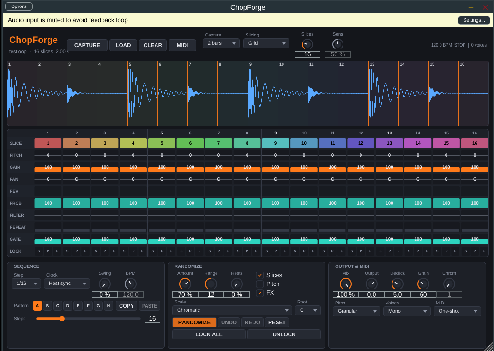

# ChopForge

ChopForge is an original, open-source **audio chopper / slicer / re-sequencer** plugin
(VST3, AU, Standalone) built with JUCE 8. It takes a loop (loaded from a file or
captured live from the track input), cuts it into slices and re-plays them through a
step sequencer that can be randomised musically, edited by hand, played from MIDI and
exported as a MIDI clip.

It was designed as an "improved take" on the commercial chop-and-remix plugins of the
same family (32-slice choppers with per-slice pitch / reverse / gain and interval-snapped
randomisation). ChopForge contains none of their code, graphics or names.



## What it does better than a typical 32-slice chopper

| Area | Typical chopper | ChopForge |
| --- | --- | --- |
| Slicing | Grid only, max 32 slices | Grid, **transient detection** or **manual markers** (drag / double-click / right-click on the waveform), up to **64 slices** |
| Source | Load a file | Load or drop a file, or **capture the live input** for 1-8 bars, bar-aligned to the host |
| Sequencer | Plays on the grid | 1-64 steps, 1/4 to 1/32 incl. triplets, swing, **8 pattern slots** (automatable), copy/paste |
| Per step | Slice, pitch, gain, reverse | Slice, pitch, gain, pan, reverse, **probability**, **LP/HP filter**, **retrigger (stutter) x1-x8**, **gate length**, 3 independent locks |
| Pitch | Varispeed | Varispeed **or granular pitch shifting that keeps the slice length** |
| Randomise | Interval snapping | 12 scales + root, pitch range, rest chance, per-category (slices / pitch / FX) switches, honours locks, **undo / redo (48 levels)** |
| MIDI | One-shot / hold | One-shot, hold, **chromatic** (play one slice across the keyboard), clock can run **host-synced, free, or MIDI-only** |
| Output | - | Dry/wet mix, output gain, declick fade, poly or mono (choke) voices, **MIDI file export of the pattern** |
| Presets | - | Audio is stored **inside the plugin state (FLAC)**, so projects reopen with the chopped loop in place |

## Building

Requirements: CMake 3.22+, a C++17 compiler, and on Linux the usual JUCE
dependencies (`libasound2-dev libx11-dev libxrandr-dev libxinerama-dev libxcursor-dev
libxcomposite-dev libxext-dev libxrender-dev libfreetype-dev libfontconfig1-dev
libgl1-mesa-dev`).

JUCE is expected in `third_party/JUCE` (git clone of tag 8.0.4). If the folder is
absent, CMake downloads it automatically.

```bash
git clone --depth 1 --branch 8.0.4 https://github.com/juce-framework/JUCE.git third_party/JUCE
cmake -S . -B build -G Ninja -DCMAKE_BUILD_TYPE=Release
cmake --build build
```

Artefacts land in `build/ChopForge_artefacts/Release/`:

- `VST3/ChopForge.vst3`
- `Standalone/ChopForge` (or `.app` / `.exe`)
- `AU/ChopForge.component` on macOS

Pass `-DCHOPFORGE_COPY_PLUGIN=ON` to copy the plugin into the user plugin folder after
each build. `-DCHOPFORGE_BUILD_TESTS=OFF` skips the test executables.

### Tests

```bash
cmake --build build --target ChopForgeTests ChopForgeHostTests
./build/ChopForgeTests_artefacts/Release/ChopForgeTests
./build/ChopForgeHostTests
```

`ChopForgeTests` checks the DSP engine (slicing, transient detection, scale snapping,
locks, voices, envelopes). `ChopForgeHostTests` drives the real `AudioProcessor` with a
fake transport: host-synced stepping, MIDI triggering, undo/redo, manual markers, state
save/restore including the FLAC-embedded audio, and MIDI export.

## Using it

1. Insert ChopForge on an audio track. **LOAD** a loop, drop a file on the window, or
   arm **CAPTURE** to record the next 1-8 bars of the track input.
2. Choose a slicing mode: **Grid** (N equal slices), **Transients** (attack detection,
   tune with *Sens*), or **Manual**. Markers are always editable on the waveform:
   drag to move, double-click to add, right-click for more.
3. The step grid shows the current pattern. Drag cells up/down (Shift = fine),
   double-click to reset, click REV or the S/P/F lock cells to toggle.
4. **RANDOMIZE** (or press `R`). Locked steps keep their slice (S), pitch (P) or FX (F).
   Choose a scale and root so random pitches stay musical. Undo with Ctrl+Z.
5. Switch patterns A-H (the slot is a parameter, so it can be automated), copy/paste
   between them, and export the pattern as a `.mid` file (C1 = slice 1).
6. Play slices from a keyboard: *MIDI* one-shot / hold from C1 upward, or *Chromatic*
   to pitch a chosen slice across the keyboard (C3 = original pitch).

The *Clock* setting decides who drives the sequencer: the host transport, an internal
free-running clock (*Free BPM*), or nothing (MIDI only). In the Standalone app the free
clock is used automatically.

## Project layout

```
Source/Engine/     header-only DSP: SampleData, Pattern, Randomizer, TransientDetector, SliceEngine
Source/UI/         LookAndFeel, WaveformView (markers), StepGrid (multi-lane editor)
Source/            PluginProcessor (sequencer, MIDI, capture, state), PluginEditor, Parameters
Tests/             EngineTests (DSP), HostTests (processor driven by a fake host)
```

## Known limitations

- No formant-preserving pitch shifting yet; *Granular* mode keeps the length, not the
  formants.
- Only the Linux VST3/Standalone build has been compiled and tested headlessly in this
  repository. macOS (AU/VST3) and Windows builds use the same CMake project but have
  not been run here.
- Stored audio is capped at 60 s per instance (32 s for live capture).

## Licensing

ChopForge's own sources are released under the GPLv3. JUCE and the VST3 SDK it pulls
in are available under GPLv3 or commercial licences; distributing a closed-source build
requires the corresponding JUCE and Steinberg agreements. "VST" is a trademark of
Steinberg Media Technologies GmbH.
